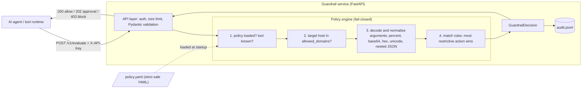

# AI Agent Tool-Call Guardrail

A small, fail-closed policy proxy that sits between an AI agent and its tools. Every tool call is
evaluated against a YAML policy and answered with **allow (200)**, **pending human approval (202)**
or **block (403)**. Every decision is written to a JSONL audit log.

## Architecture



| File | Role |
|---|---|
| `src/guardrail/main.py` | FastAPI app, auth, status codes, audit-or-block |
| `src/guardrail/policy_engine.py` | Strict YAML loader, normalisation/decoding, rule evaluation |
| `src/guardrail/schemas.py` | Pydantic v2 models for requests, policy and decisions |
| `src/guardrail/audit.py` | Append-only JSONL audit log (arguments are never logged) |

## Decision rules

1. No valid policy, unknown tool, unexpected error, or oversized/over-encoded arguments: **block**.
2. Target host not in the global `allowed_domains`: **block** (egress allowlist, applies to every tool).
3. All matching rules are collected; the **most restrictive** wins (`block` > `require_approval` > `allow`).
4. No rule matched: `default_action` (`block` or `require_approval`, never `allow`).

Clients must treat **anything other than 200 as "do not run the tool"**.

## Quick start

```bash
# Docker
docker build -t guardrail .
docker run --rm -p 8000:8000 \
  -e GUARDRAIL_API_KEY="$(openssl rand -hex 32)" \
  -v guardrail-logs:/var/log/guardrail guardrail

# Local
pip install -e ".[dev]"
GUARDRAIL_API_KEY="$(openssl rand -hex 32)" uvicorn guardrail.main:app
pytest -q
```

```bash
curl -s -X POST localhost:8000/v1/evaluate \
  -H "X-API-Key: $GUARDRAIL_API_KEY" -H "Content-Type: application/json" \
  -d '{"agent_id":"agent-1","tool_name":"run_sql","arguments":{"q":"dElEtE FROM users"},
       "target_url":"https://api.example.com/query"}'
# -> 403 {"decision":"block","matched_rule_ids":["block-destructive-sql","allow-basic-tools"], ...}
```

| Endpoint | Result |
|---|---|
| `POST /v1/evaluate` | `200` allow, `202` approval required (body has `approval_id`), `403` block, `401` bad key, `413` body > 1 MiB, `422` malformed payload |
| `GET /healthz` | `200`, or `503` if the policy failed to load |

Environment: `GUARDRAIL_API_KEY` (required, 16+ chars; the service will not start without it),
`GUARDRAIL_POLICY_PATH`, `GUARDRAIL_AUDIT_LOG`, `GUARDRAIL_ALLOW_UNAUTHENTICATED=true` (local dev only).

## Sample `policy.yaml`

```yaml
# Guardrail policy. Anything not explicitly allowed is blocked.
#
# Evaluation: tool must be known -> target host must be in allowed_domains ->
# all matching rules are collected -> the most restrictive action wins
# (block > require_approval > allow). No match falls back to default_action.
#
# Strict YAML: no anchors/aliases, no duplicate keys, max 256 KiB.
version: 1
default_action: block

# Global egress allowlist, applied to EVERY tool. "example.com" = exact host,
# "*.example.com" = subdomains only (not the apex). Add the apex separately.
allowed_domains:
  - api.example.com
  - db.example.com
  - "*.internal.example.com"

rules:
  # 1) Destructive SQL in ANY string argument of ANY tool. Matched case-insensitively
  #    after decoding (percent/base64/hex/\u escapes/HTML entities) and Unicode folding.
  - id: block-destructive-sql
    description: Block DELETE / DROP / TRUNCATE hidden anywhere in arguments.
    action: block
    tool_names: ["*"]
    conditions:
      sql_keywords:
        - keywords: [DELETE, DROP, TRUNCATE]

  # 2) Prompt-injection phrasing (illustrative; extend with your own patterns).
  - id: block-prompt-injection
    description: Block obvious instruction-override phrases.
    action: block
    tool_names: ["*"]
    conditions:
      regex:
        - pattern: 'ignore\s+(all\s+)?(previous|prior)\s+instructions'

  # 3) Data-exfiltration control: HTTP tools may only call api.example.com
  #    (a subset of allowed_domains). Allow rules may only use "domains" conditions.
  - id: allow-http-to-api
    description: HTTP tools may only reach the main API host.
    action: allow
    tool_names: [http_request, web_fetch]
    conditions:
      domains:
        - api.example.com

  # Low-risk tools. Still subject to every block rule above and to allowed_domains.
  - id: allow-basic-tools
    description: Read-only tools.
    action: allow
    tool_names: [run_sql, search_docs, read_file]

  # 4) Sensitive tools always need a human.
  - id: approve-sensitive-tools
    description: These tools never run without human approval.
    action: require_approval
    tool_names: [send_email, transfer_funds, delete_file, execute_shell]
```

Policy rules enforced at load time (a violation means the whole policy is rejected and everything is blocked):
`allowed_domains` is required; `allow` rules must name specific tools and may only use `domains`
conditions; `default_action` cannot be `allow`; regexes prone to catastrophic backtracking are rejected;
YAML anchors, aliases and duplicate keys are rejected; files over 256 KiB are rejected.

## Audit log

One JSON object per line in `logs/audit.jsonl` (mode 0600), for example:

```json
{"timestamp":"2026-11-23T20:21:09+00:00","request_id":"9855b00a-...","agent_id":"agent-1","tool_name":"run_sql","decision":"block","matched_rules":["block-destructive-sql"],"reason":"block by rule(s): block-destructive-sql","fail_closed":false}
```

If an audit write fails, allow and approval decisions are converted to blocks. Rotate the file externally.

## Security review: bypasses found and patched

| Bypass | Fix |
|---|---|
| Percent-encoded, double-encoded, `\uXXXX`, HTML-entity, base64 and hex payloads | Arguments are decoded for matching, up to 3 layers; a 4th layer is blocked |
| Fullwidth, zero-width, combining-accent, Cyrillic/Greek/small-cap lookalikes | NFKD folding, invisible/combining characters stripped, lookalike table |
| `/*!50000DELETE*/` and comment-split keywords | Matched raw, comment-stripped and comment-unwrapped |
| JSON hidden inside a string argument, or deep nesting | Strings that parse as JSON are walked; depth, node and size limits block |
| URL parser differentials: `user@host`, `\`, `%2E` hosts, embedded whitespace | Rejected by the schema instead of normalised |
| Tools without a domain rule could target any host | Global `allowed_domains` applies to every tool |
| Pattern-based `allow` rules (encoding makes them match) | Allow rules may only use `domains` |
| YAML duplicate keys silently overriding rules; alias bombs | Strict loader rejects both; `SafeLoader` only; size cap |
| ReDoS in policy regexes (a 27-character input stalled evaluation for 5.6 s) | Nested unbounded repeats and alternations under repeats are rejected at load |
| Unauthenticated endpoint, unbounded bodies | `X-API-Key` (constant-time compare), 1 MiB limit, auth checked before audit writes |

## Known limitations

Keyword blocking is defence in depth, not a proof. These still get through, and are pinned as expected-failure tests:
string concatenation (`'DEL'||'ETE'`), `CHAR(68,69,...)`, ROT13, and other novel encodings.

- Give SQL tools a **read-only database role** and parameterised queries. That is the real control.
- When you add forwarding: send the validated, canonical `target_url`, never the raw body; disable redirects; block private IP ranges after DNS resolution (DNS rebinding is out of scope here).
- Domain checks use `target_url` only. URLs hidden inside arguments are not checked.
- Put a body-size limit on your ingress too (chunked uploads have no `Content-Length`).
- Pin and hash dependencies for production builds.
